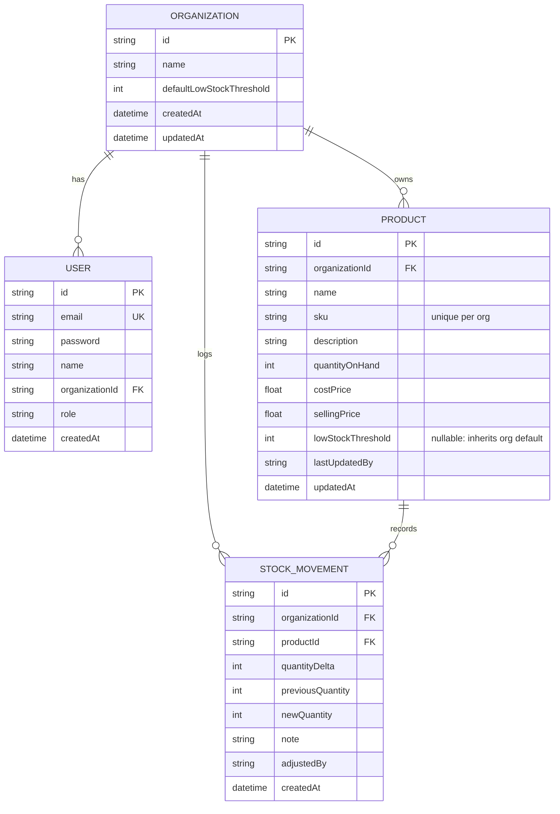

# StockFlow — SaaS Multi-Tenant Inventory Management System (MVP)

[](https://nodejs.org/)
[](https://reactjs.org/)
[](https://vitejs.dev/)
[](https://tailwindcss.com/)
[](https://www.prisma.io/)
[](https://www.sqlite.org/)
[](LICENSE)

StockFlow is a streamlined, high-performance, multi-tenant SaaS inventory management system designed for modern e-commerce brands, logistics teams, and small sellers. It provides real-time stock control, tenant-isolated data structures, low-stock threshold monitoring, and swift stock adjustments.

---

## 🚀 Key Features & PRD Compliance

| Requirement | PRD Feature | Implementation Details | Status |
|---|---|---|:---:|
| **FR-1** | **Signup & Login** | Multi-tenant user registration with organization auto-provisioning, bcrypt password hashing, and secure JWT authentication. | ✅ Done |
| **FR-2** | **Organization Context** | Strict multi-tenancy. Every catalog item, setting, and stock movement is scoped by `organizationId`. Complete tenant isolation verified by tests. | ✅ Done |
| **FR-3** | **Product Model** | Robust schema: Name, SKU (unique per org), Quantity on Hand, Cost Price, Selling Price, Low Stock Threshold, and Audit timestamps. | ✅ Done |
| **FR-4** | **Product CRUD** | Full CRUD with real-time search (by SKU or Name), status filter pills (Low Stock, Healthy, Out of Stock), and confirmation modal for deletes. | ✅ Done |
| **FR-5** | **Simple Stock Updates** | Inline fast-action modal for `+/- N units` adjustments with audit notes, preventing stock from falling below 0. | ✅ Done |
| **FR-6** | **Dashboard Overview** | Executive summary cards (Total Products, Units on Hand, Low Stock Alerts, Catalog Valuation), plus a dedicated Low Stock table sorted by urgency. | ✅ Done |
| **FR-7** | **Global Settings** | Configurable default low-stock threshold at the organization level with automatic product fallback fallback logic. | ✅ Done |

---

## 🛠 Tech Stack

- **Frontend**: React 18, Vite, Tailwind CSS, Lucide React, React Router v6, Axios
- **Backend**: Node.js, Express.js, Prisma ORM, JSON Web Tokens (JWT), bcryptjs, Zod
- **Database**: SQLite (Zero-config, portable, easily swappable to PostgreSQL/MySQL via Prisma)
- **Testing**: Jest, Supertest
- **DevOps / Deployment**: Docker multi-stage build, Docker Compose, Render Blueprint

---

## 📊 Multi-Tenant Architecture & Data Model



---

## ⚡ Quick Start (Local Setup)

### 1. Clone the repository
```bash
git clone https://github.com/madhuvarshitha2005/StockFlow.git
cd StockFlow
```

### 2. Install all dependencies
```bash
# Install root, server, and client dependencies
npm --prefix server install
npm --prefix client install
```

### 3. Initialize Database & Seed Demo Data
```bash
cd server
npx prisma db push
node prisma/seed.js
cd ..
```

### 4. Run Development Servers
```bash
# Starts both Express API (:5000) and Vite React Client (:5173) concurrently:
npm run dev
```
Open **[http://localhost:5173](http://localhost:5173)** in your browser.

---

## 🔑 Demo Accounts

Use any of these pre-seeded accounts or create a new organization:

| Account | Email | Password | Organization | Characteristics |
|---|---|---|---|---|
| **Demo Store (Apex)** | `demo@stockflow.io` | `Password123!` | Apex Retail Logistics | 8 diverse products, low-stock items, out-of-stock items, stock movement history. |
| **Tenant Isolation Test** | `owner@stellargoods.com` | `Password123!` | Stellar Goods & Apparel | Separate tenant demonstrating complete data isolation. |

*(The login screen also features **1-Click Demo Login** buttons for instant access).*

---

## 🧪 Automated Testing

The project includes automated integration tests covering authentication, tenant isolation, SKU collision prevention across tenants, CRUD workflows, and stock threshold logic:

```bash
cd server
npm test
```

### Test Coverage Highlights:
- ✅ Organization auto-creation on user signup
- ✅ Unique email constraints
- ✅ Tenant isolation (Org A cannot view or manipulate Org B's products)
- ✅ Tenant-scoped SKU uniqueness (SKU collision allowed across different tenants, but prohibited within the same tenant)
- ✅ Stock adjustment (+/- delta) and negative stock prevention
- ✅ Dashboard statistics and low-stock threshold fallback logic
- ✅ Hard deletion with cascading constraints

---

## 🐳 Docker Deployment

Run the complete fullstack production container with a single command:

```bash
docker-compose up --build -d
```
Access the application at **[http://localhost:5000](http://localhost:5000)**.

---

## ☁️ Cloud Deployment Guide

### Deploying to Render
1. Push this repository to GitHub.
2. In Render, select **New +** -> **Blueprint**.
3. Connect your GitHub repository. The included `render.yaml` automatically sets up the build commands, environment variables, and zero-downtime execution.

### Deploying to Railway / Fly.io / VPS
The repository includes a production-grade multi-stage `Dockerfile`. Simply deploy with Docker and expose port `5000`.

---

## 📡 API Endpoints Overview

| Method | Endpoint | Description | Scoped to Org |
|---|---|---|:---:|
| `POST` | `/api/auth/signup` | Register user & organization | ❌ |
| `POST` | `/api/auth/login` | Authenticate user & receive JWT | ❌ |
| `GET` | `/api/auth/me` | Retrieve active profile & organization | ✅ |
| `GET` | `/api/dashboard/stats` | Summary KPI metrics & low stock table | ✅ |
| `GET` | `/api/products` | List all products (supports `?search=`) | ✅ |
| `GET` | `/api/products/:id` | Get product details with movement history | ✅ |
| `POST` | `/api/products` | Create product (validates SKU per org) | ✅ |
| `PUT` | `/api/products/:id` | Update product details | ✅ |
| `POST` | `/api/products/:id/adjust-stock` | Fast +/- stock adjustment with note | ✅ |
| `DELETE` | `/api/products/:id` | Delete product | ✅ |
| `GET` | `/api/settings` | Get organization settings | ✅ |
| `PUT` | `/api/settings` | Update default threshold / org name | ✅ |

---

## 📄 License
This project is licensed under the [MIT License](LICENSE).
